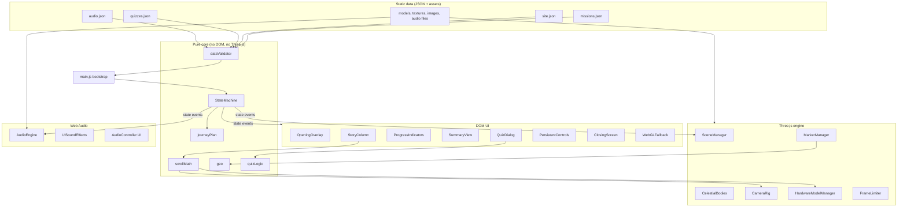
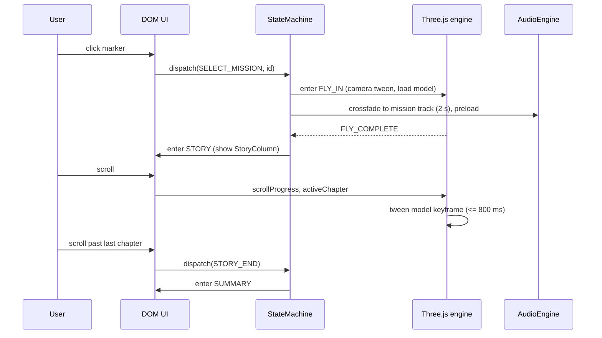
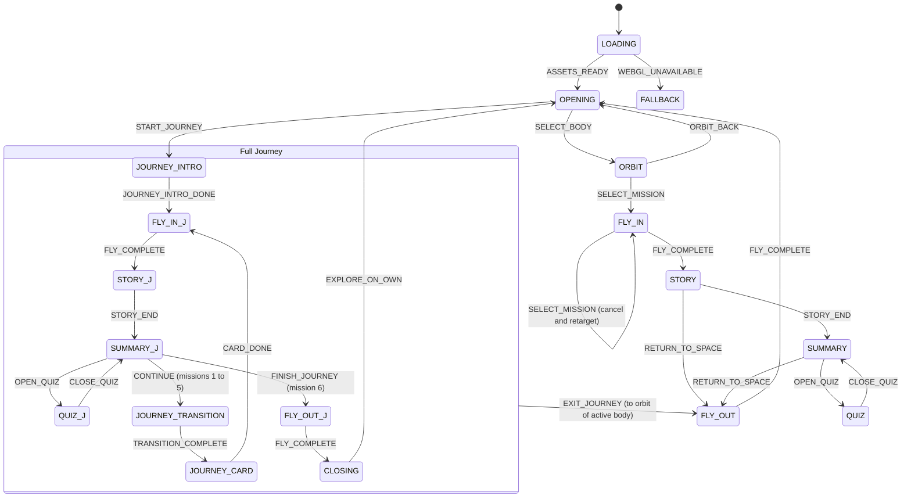
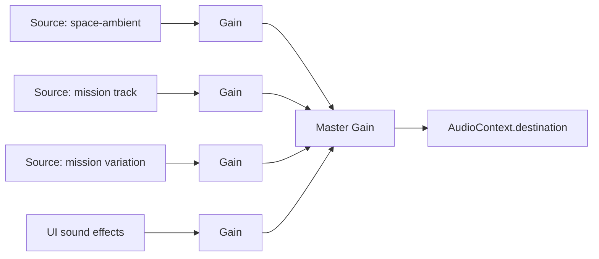

# Design Document

## Overview

Silent Explorers is a single-page, static website for readers aged 10 to 17, built by one developer for NASA Space Apps 2026. It tells the first-person stories of six pieces of NASA hardware left on the Moon and Mars: Surveyor 3, Apollo 11 Eagle, Apollo 17 rover, Viking 1, Opportunity and InSight.

The design uses plain HTML, CSS and JavaScript (ES modules) with Three.js, bundled by Vite. There is no backend. Everything the site shows is either a static asset or a static JSON data file.

Key design decisions:

- **One persistent canvas.** A single full-screen Three.js canvas lives under all UI for the whole session. The opening scene, orbit view, fly-ins and stories all render into it. The canvas is never torn down, so transitions are continuous (Requirements 1, 2, 4, 6.1).
- **Split-screen story layout.** During a story the Hardware_Model is framed in the left half of the canvas using a camera view offset. An HTML story column overlays the right half with `rgba(10, 10, 15, 0.85)` so stars show through faintly (Requirements 6.2, 12.10).
- **Explicit state machine.** One finite state machine owns the app mode (opening, orbit, fly-in, story, summary, quiz, journey transitions, closing). Every module reacts to state changes and never decides navigation itself.
- **Content as data.** Missions, chapters, images, captions, citations, quiz questions, camera keyframes and audio track ids live in JSON under `src/data/`. The engine contains no mission text.
- **Pure core, thin shell.** Logic that can be tested without a browser (scroll normalisation, chapter lookup, geo conversion, quiz shuffle, state transitions, data validation) is written as pure functions. Three.js, DOM and Web Audio code is a thin layer on top.
- **Scrollytelling via scroll position.** A native scrolling story column drives a normalised Scroll_Progress, which maps to chapter activation and Hardware_Model keyframes.

### Research Summary

- Three.js `PerspectiveCamera.setViewOffset` shifts the projection so the rendered subject appears in part of a larger canvas. This allows a full-screen canvas with the model centred in the left half, without a second canvas or CSS tricks. Source: [Three.js PerspectiveCamera docs](https://threejs.org/docs/#api/en/cameras/PerspectiveCamera).
- `GLTFLoader` and `OBJLoader` are in `three/examples/jsm/loaders/`. NASA 3D models are offered mainly as GLB/GLTF or OBJ. Source: [NASA 3D Resources](https://nasa3d.arc.nasa.gov/models).
- `IntersectionObserver` is the right primitive for reveal animations and chapter activation. A scroll listener plus `getBoundingClientRect` is used only for the continuous progress value, and is throttled with `requestAnimationFrame`. Source: [MDN IntersectionObserver](https://developer.mozilla.org/en-US/docs/Web/API/Intersection_Observer_API).
- Web Audio autoplay is blocked until a user gesture. An `AudioContext` created before the gesture starts in the `suspended` state and must be `resume()`d inside a gesture handler. Source: [MDN Autoplay guide](https://developer.mozilla.org/en-US/docs/Web/Media/Guides/Autoplay).
- Equal-power or linear gain ramps on `GainNode.gain` (`linearRampToValueAtTime`) give click-free crossfades. Source: [MDN GainNode](https://developer.mozilla.org/en-US/docs/Web/API/GainNode).
- The WAI-ARIA Authoring Practices modal dialog pattern requires `role="dialog"`, `aria-modal="true"`, a label, focus moved in, focus trapped, Escape to close and focus restored to the invoker. The native `<dialog>` element with `showModal()` provides most of this. Source: [WAI-ARIA APG Dialog (Modal)](https://www.w3.org/WAI/ARIA/apg/patterns/dialog-modal/).
- Great-circle distance uses the haversine formula. Lunar mean radius is 1737.4 km and Mars mean radius is 3389.5 km. Source: [NASA Moon Fact Sheet](https://nssdc.gsfc.nasa.gov/planetary/factsheet/moonfact.html), [NASA Mars Fact Sheet](https://nssdc.gsfc.nasa.gov/planetary/factsheet/marsfact.html).
- Textures come from [Solar System Scope](https://www.solarsystemscope.com/textures/) (Moon and Mars colour maps, 2K for school laptops). Chapter_Images come from [images.nasa.gov](https://images.nasa.gov).

Content was rephrased for compliance with licensing restrictions.

### Scope Notes and Clarifications

- Requirement 6.3 allows 3 to 6 chapters. The agreed per-mission counts are Surveyor 3 = 6, Apollo 11 = 4, Apollo 17 = 4, Viking 1 = 5, Opportunity = 4, InSight = 5. All lie inside 3 to 6, and the data validator enforces both the range and the exact counts.
- The end-of-story summary is shown after the last chapter and is not counted as a chapter. The scroll progress indicator counts only chapters.
- The "Return to Space" persistent button (6.19) is visible during Mode 1 stories. In Full Journey, the persistent control is "Exit Journey" (10.9) in the same bottom-right position. They are never shown together.
- The baseline NASA-published landing coordinates in the data files must be double-checked by the developer against NASA mission reports before submission (Requirement 9.3).

## Architecture

### Layered View



### Runtime Flow



### Project Layout

```
index.html
vite.config.js
src/
  main.js                  bootstrap, wiring
  core/
    stateMachine.js
    scrollMath.js
    geo.js
    quizLogic.js
    journeyPlan.js
    dataValidator.js
    layoutSelector.js      split or stacked layout from viewport width
    contrast.js            WCAG contrast helper (used by tests)
  engine/
    sceneManager.js
    celestialBodies.js
    starfield.js
    markerManager.js
    cameraRig.js
    hardwareModelManager.js
    frameLimiter.js
    qualityController.js   adaptive quality levels (pure)
    webglSupport.js
  ui/
    openingOverlay.js
    storyColumn.js
    progressIndicators.js
    summaryView.js
    quizDialog.js
    persistentControls.js
    closingScreen.js
    transitionCards.js
    webglFallback.js
    toast.js
  audio/
    audioEngine.js
    uiSounds.js
    audioController.js
  data/
    site.json
    missions.json
    quizzes.json
    audio.json
  styles/
    tokens.css  base.css  story.css  dialog.css
public/
  models/  textures/  images/  audio/
tests/
```

### Key Architectural Decisions

| Decision | Rationale |
|---|---|
| Single persistent canvas with `setViewOffset` for the left-half model | Avoids a second renderer, keeps starfield visible behind the story column, no GPU context churn on mode changes (6.1, 12.10). |
| Finite state machine as the only navigation authority | Modes interact (quiz inside journey inside summary). One table of transitions prevents impossible combinations and is directly property-testable. |
| Story column is a normal scrolling DOM element, not a virtual scroll | Native scrolling is accessible, works with touch, keyboard and assistive tech. Scroll progress is derived, not driven. |
| JSON data plus a validator run at build time and at load | Keeps content editable, and catches chapter counts, missing citations, bad domains and quiz shape before they reach users. |
| Pure functions for maths and logic | Enables fast property tests with fast-check and no browser. |
| No UI framework | Hackathon scope. Modules are small and communicate via the state machine and a tiny event emitter. |
| Vitest and fast-check | Native Vite integration, ESM, and a standard PBT library for JavaScript. |

## Components and Interfaces

### Core Modules

#### `stateMachine.js`

Owns the app state and a transition table. Pure: `transition(state, event) -> state`. A thin wrapper holds the current state and notifies subscribers.

```js
// State shape
{
  mode: 'EXPLORE' | 'JOURNEY',
  screen: 'LOADING' | 'OPENING' | 'ORBIT' | 'FLY_IN' | 'STORY' | 'SUMMARY'
        | 'QUIZ' | 'FLY_OUT' | 'JOURNEY_INTRO' | 'JOURNEY_TRANSITION'
        | 'JOURNEY_CARD' | 'CLOSING' | 'FALLBACK',
  body: 'moon' | 'mars' | null,
  missionId: string | null,
  journeyIndex: number | null,   // 0..5 while mode === 'JOURNEY'
  resumeScreen: 'SUMMARY' | null // where QUIZ returns to
}

transition(state, event): State   // pure, returns same state for invalid events
createStore(initial): { getState, dispatch, subscribe }
```

Events: `ASSETS_READY`, `WEBGL_UNAVAILABLE`, `SELECT_BODY`, `SELECT_MISSION`, `FLY_COMPLETE`, `STORY_END`, `OPEN_QUIZ`, `CLOSE_QUIZ`, `RETURN_TO_SPACE`, `ORBIT_BACK`, `START_JOURNEY`, `JOURNEY_INTRO_DONE`, `CONTINUE`, `TRANSITION_COMPLETE`, `CARD_DONE`, `FINISH_JOURNEY`, `EXIT_JOURNEY`, `EXPLORE_ON_OWN`.

#### `scrollMath.js`

```js
// Normalises scroll position inside a range to [0, 1]
normalizeProgress(scrollTop, rangeStart, rangeEnd): number

// Given chapter ranges sorted by start, returns the active chapter index or -1
activeChapterIndex(scrollTop, chapterRanges): number

// Overall narrative progress across chapters only (summary excluded), 0..1
overallProgress(scrollTop, chapterRanges): number

// "Chapter n of N" for the indicator (summary not counted)
chapterLabel(activeIndex, chapterCount): { current, total }

// Interpolates between two keyframes for a given t in [0, 1]
interpolateKeyframe(a, b, t): Keyframe

// Whether the scroll position is past the last chapter (summary should show)
isPastLastChapter(scrollTop, chapterRanges): boolean
```

`normalizeProgress` clamps. A degenerate range (`end <= start`) returns 0 for positions before or at `start` and 1 otherwise, so division by zero cannot occur.

#### `geo.js`

```js
latLonToVector3(latDeg, lonDeg, radius): { x, y, z }   // lon east-positive, matches texture UV
vector3ToLatLon(v): { lat, lon }
greatCircleKm(a, b, radiusKm): number                   // haversine
BODY_RADIUS_KM = { moon: 1737.4, mars: 3389.5 }
```

Convention: `x = r cos(lat) cos(lon)`, `y = r sin(lat)`, `z = -r cos(lat) sin(lon)`, with the texture's prime meridian aligned to +X. This is checked once visually against known landmarks (Tranquility Base on the near side).

#### `quizLogic.js`

```js
// Returns a new quiz instance with questions and choices shuffled.
// Each choice keeps its identity (id), so correctness is by id, never by position.
buildQuizSession(quiz, rng = Math.random): QuizSession

// Pure Fisher-Yates, does not mutate input.
shuffle(array, rng): array

scoreAnswer(question, chosenId): { correct: boolean, explanation: string }
scoreSession(answers): { score: 0|1|2|3, total: 3, message: string }
messageForScore(score): string      // always non-empty
```

#### `journeyPlan.js`

```js
JOURNEY_ORDER = ['surveyor3','apollo11','apollo17','viking1','opportunity','insight']
nextMission(journeyIndex): { index, missionId } | null
continueLabel(journeyIndex): 'Continue to Next Mission' | 'Finish the Journey'
journeyProgressLabel(index, missions): 'Mission 2 of 6 · Apollo 11'
```

The order is derived from mission `year` and `journeyOrder` in the data, and validated against `JOURNEY_ORDER`.

#### `dataValidator.js`

Validates all JSON at load (and as a Vitest/CI check). Returns `{ ok, errors[] }`.

It also exports `validateAssetBudget(assets)`, which enforces the asset budgets in Requirement 13.9 (see "Responsive and Mobile Design").

Checks: expected chapter counts per mission, chapters in 3 to 6, at least one image per chapter, caption length at most 120, image URLs on `images.nasa.gov` or `images-assets.nasa.gov`, at least one citation per mission, citation hosts equal `nasa.gov` or end with `.nasa.gov`, quiz has exactly 3 questions of 4 choices with exactly one correct choice, camera keyframes present for each chapter, audio track ids resolve, marker coordinates within 100 km of the published reference coordinates, tooltip text at most 80 characters, one-sentence description at most 160 characters.

#### `contrast.js`

WCAG 2.1 relative luminance and contrast ratio helper. Used by tests to assert text and background tokens meet 4.5:1 (Requirements 8.3, 12.9, 12.12).

### Engine Modules

#### `sceneManager.js`

Creates the renderer, scene, lights and the render loop. Delegates frame pacing to `frameLimiter`.

```js
init(canvas): { scene, camera, renderer }
start(): void
setSplitLayout(enabled: boolean): void   // toggles camera.setViewOffset for left-half framing
onResize(): void
dispose(): void
```

Uses `renderer.setPixelRatio(Math.min(devicePixelRatio, 2))` and listens to `webglcontextlost`.

#### `frameLimiter.js`

```js
shouldRenderFrame(nowMs, lastRenderMs, maxFps = 60): boolean
```

Pure. The render loop runs on `requestAnimationFrame` and skips a frame when less than `1000 / 60` ms (with a small tolerance) has elapsed since the last render. This guarantees no more than 60 rendered frames per second on 120 Hz or 144 Hz displays (Requirement 1.4).

#### `qualityController.js`

Pure module that decides the rendering quality level from measured frame rates. The render loop measures fps and keeps the counters. This module only maps them to a level. See "Responsive and Mobile Design" for the levels and rules (Requirement 13.9).

```js
QUALITY_LEVELS            // index 0 = best quality, last index = minimum level
MAX_LEVEL = QUALITY_LEVELS.length - 1
nextQualityLevel(currentLevel, recentFps, secondsBelow30, secondsAtOrAbove55 = 0): number
```

#### `celestialBodies.js`

Builds Moon and Mars spheres (`SphereGeometry` 64 by 64) with Solar System Scope colour maps. Each sphere is sized so it takes at least 5% of the viewport width from the initial camera position. Exposes `getMesh(body)`, `getRadius(body)`.

#### `starfield.js`

Generates N >= 2000 points using a seeded stratified distribution so every viewport quadrant has at least 100 points. Uses a single `THREE.Points` with a `BufferGeometry`.

```js
generateStarPositions(count, seed): Float32Array
countStarsPerQuadrant(positions, camera): [n1, n2, n3, n4]   // used by tests
```

#### `markerManager.js`

Creates six `Mission_Marker` objects, three per body, as small glowing sprites parented to the body mesh so they rotate with it. Pulse is done in the vertex or sprite scale in the render loop. Screen radius is clamped to at most 2% of the smaller viewport dimension.

```js
createMarkers(missions, bodies): Marker[]
setHover(markerId | null): void
raycastPick(pointerNdc): markerId | null
focusMarker(markerId): void         // keyboard support
```

Each marker has a matching hidden-but-focusable DOM button (`<button class="marker-proxy">`) positioned at the projected screen position. This gives keyboard focus, a focus ring, and screen reader names, and activates the same event as a click (Requirements 3.4, 3.5, 8.4).

If constructing a marker throws, a static fallback sprite is placed at the same coordinates, the error is logged with `console.error`, and the remaining markers are still built (Requirement 3.6).

#### `cameraRig.js`

```js
flyTo(target: CameraPose, opts: { durationMs, ease }): Promise<void>
cancelFly(): void
setInputEnabled(enabled: boolean): void
orbitBy(dx, dy): void
zoomBy(delta): void
```

- `flyTo` interpolates position and look-at target with `easeInOutCubic`. A new `flyTo` call cancels the current one and starts from the current interpolated pose (Requirement 4.5).
- Input handlers are ignored while `isFlying` (Requirement 2.5).
- Zoom distance is clamped between `bodyRadius * 1.15` and a far limit so the camera never enters a body and a body stays in view (Requirement 2.2).
- Durations: body focus 2 to 4 s (default 3 s). Mission fly-in 2 to 5 s (default 3.5 s).

```js
easeInOutCubic(t): number    // pure, exported for tests
clampZoom(distance, minDistance, maxDistance): number
```

#### `hardwareModelManager.js`

```js
load(missionId): Promise<Object3D>      // returns model or placeholder
show(missionId, anchorPose): void
applyKeyframe(keyframe, durationMs <= 800): void
unload(): void                           // removes from scene and disposes geometry, materials, textures
fitToView(object, camera): void          // scale so full model fits in the left half
```

- GLTF files are loaded with `GLTFLoader` and OBJ files with `OBJLoader`, selected by file extension in the data.
- The model is positioned at the mission site anchor on the body surface (within 10 m of recorded coordinates, expressed in scene units by the body scale factor).
- Lighting: one `AmbientLight` and one `DirectionalLight` (plus a soft fill) are always present so no face is fully unlit (Requirement 5.5). Per-chapter keyframes may adjust the directional light angle or intensity, but never drop ambient below a minimum.
- Model controls: drag to rotate on both axes, and wheel or pinch to zoom, with the zoom multiplier clamped to 0.5 to 5.
- On load failure, a placeholder (wireframe box) with a text sprite "`<Mission name>` – model unavailable" is shown and the toast "The 3D model could not be loaded." appears (Requirements 4.6, 5.6).

```js
clampModelZoom(z): number   // clamp to [0.5, 5]
```

### UI Modules

| Module | Responsibility | Requirements |
|---|---|---|
| `openingOverlay.js` | Title, subtitle, Moon/Mars selection controls, "Experience the Full Journey" button, body label. Text comes from `site.json`. | 1.6, 2.6, 10.1 |
| `storyColumn.js` | Renders chapters, images, captions, callouts, citations from data. Sets up `IntersectionObserver` reveals and the scroll listener. Emits `chapterActivated` and `progress` events. | 6.2 to 6.4, 6.12, 6.16 to 6.18, 9.2, 9.5 |
| `progressIndicators.js` | Scroll progress indicator (chapter x of N) and the Journey indicator ("Mission 2 of 6" plus name). | 6.15, 10.7 |
| `summaryView.js` | End-of-story summary: mission name, hardware, dates, final status, then "Test what you learned", then the action ("Return to Space", "Continue to Next Mission" or "Finish the Journey"). | 6.13, 6.14, 7.1, 10.5 |
| `quizDialog.js` | Quiz dialog (native `<dialog>`), focus trap, Escape, X close, feedback, score, retake. | 7.2 to 7.7 |
| `persistentControls.js` | Bottom-right "Return to Space" (Mode 1) or "Exit Journey" (Journey). Hover and focus 120% scale. | 6.19, 10.9 |
| `transitionCards.js` | Journey intro card (1967 to 2022) and per-mission transition card (at most 3 s). | 10.2, 10.6 |
| `closingScreen.js` | Closing summary with all six missions and "Explore on Your Own". | 10.8 |
| `toast.js` | Non-blocking messages (model unavailable, auto-dismiss in 5 s). | 4.6, 5.6 |
| `webglFallback.js` | Static message shown when WebGL is missing. | 1.5, 8.6 |

Touch behaviour (Requirement 13, see "Responsive and Mobile Design"): `persistentControls.js` handles safe-area placement and press feedback for its buttons, `quizDialog.js` handles the full-width panel and the 44 by 44 px close icon, `openingOverlay.js` handles press feedback on the opening buttons, and `markerManager.js` handles persistent mission-name labels and 44 by 44 px proxy buttons.

Common UI contract:

```js
mount(parent, props): { el, destroy }
```

All visible text and labels originate from JSON or constants in a single `strings.js`, so nothing is hard-coded inside layout code.

### Audio Modules

#### `audioEngine.js`

```js
init(audioConfig): void                  // creates AudioContext lazily (suspended)
unlockOnGesture(): Promise<void>         // call from first pointerdown/keydown/click
playTrack(trackId, { fadeMs = 2000 }): void
crossfadeTo(trackId, { fadeMs = 2000 }): void
preload(trackId): Promise<void>
setMuted(muted: boolean): void
isMuted(): boolean
pushContext(trackId): void               // used by quiz: remember current track, crossfade to space ambient
popContext(): void                       // crossfade back to the remembered track variation
```

Design:

- Each track is an `AudioBuffer` (decoded) played with `AudioBufferSourceNode` (loop) through its own `GainNode` into a master `GainNode`.
- Crossfade ramps the outgoing gain to 0 and the incoming gain from 0 to its target over `fadeMs` using `linearRampToValueAtTime`. Outgoing sources are stopped after the ramp.
- Mute sets the master gain to 0 immediately and suspends the context. Unmute is only done by the Audio_Controller button. Transitions requested while muted update the logical "current track" but produce no sound (Requirements 11.8, 11.12).
- Opportunity's final chapter uses the `variation` track id from `audio.json` (quiet, lower register) (Requirement 11.5).
- The next mission's track is preloaded when the fly-in starts (Requirement 11.10).

Pure helper used by tests:

```js
resolveTrack(state, chapterIndex, audioConfig): trackId
// opening/orbit/closing -> 'space-ambient'; QUIZ -> 'space-ambient';
// story/summary -> mission.track, or mission.finalChapterVariation for Opportunity's last chapter
```

#### `uiSounds.js`

Short one-shot buffers (`hover-blip`). `playHover()` is a no-op until the audio is unlocked, and is silent when muted.

#### `audioController.js`

A persistent mute toggle button (`aria-pressed`, labelled "Mute audio" or "Unmute audio") fixed top-right. Visible in every view, including the closing screen and quiz dialog (the dialog uses `inert` on the background and the control stays outside the quiz stacking context only as a keyboard shortcut `M`, so it does not violate the focus trap).

### Interaction Specs

- Borderless text buttons (`.btn-text`): Orbitron, `#FFFFFF`, no border or background, `transition: transform 180ms ease`, `:hover` and `:focus-visible` apply `transform: scale(1.2)`. Focus also shows an outline of 2 px `#A8D8EA` (contrast above 3:1 against the dark background). Hover and focus trigger `uiSounds.playHover()`.
- Reduced motion: when `prefers-reduced-motion: reduce` is set, reveals use opacity only, scale-on-hover is reduced to a colour/underline change, and camera tweens use the minimum allowed durations.

## Application State Machine

### States

| Screen | Description |
|---|---|
| `LOADING` | Assets loading, spinner shown. |
| `FALLBACK` | WebGL unsupported, static message only. |
| `OPENING` | Opening scene with title, subtitle, both bodies, Journey button. |
| `ORBIT` | Camera framed on one body, markers selectable, body label shown. |
| `FLY_IN` | Camera flying to a mission site; input disabled. |
| `STORY` | Sticky canvas with split layout, scrolling chapters. |
| `SUMMARY` | End-of-story summary. |
| `QUIZ` | Quiz dialog open over the summary. |
| `FLY_OUT` | Camera returning to orbit or opening view; input disabled. |
| `JOURNEY_INTRO` | Intro title card (1967 to 2022). |
| `JOURNEY_TRANSITION` | Fly out from the current site, fly in to the next. |
| `JOURNEY_CARD` | Transition card for next mission (at most 3 s). |
| `CLOSING` | Closing summary over the opening scene. |

### Diagram



`FLY_IN_J`, `STORY_J`, `SUMMARY_J`, `QUIZ_J` and `FLY_OUT_J` are the same screens as their Mode 1 counterparts, differentiated by `mode === 'JOURNEY'` in the state shape. The diagram separates them only for readability.

### Transition Rules

- `SELECT_MISSION` is valid in `ORBIT` and `FLY_IN` (retarget, Requirement 4.5), only in `EXPLORE` mode.
- `RETURN_TO_SPACE` is valid in `STORY`, `SUMMARY` and `FLY_IN` in `EXPLORE` mode, and moves to `FLY_OUT` then `OPENING` (Requirement 6.19 asks for the opening view with both bodies). From the end-of-story summary, "Return to Space" returns the camera to the orbital view of the current Celestial_Body (Requirement 6.14), which is `ORBIT` for that body. The persistent button returns to `OPENING` (Requirement 6.19). The two cases are distinguished by event payload `{ target: 'orbit' | 'opening' }`.
- `OPEN_QUIZ` is valid only in `SUMMARY`. It records `resumeScreen = 'SUMMARY'`. `CLOSE_QUIZ` returns to `SUMMARY` without altering `missionId` or `journeyIndex` (Requirement 7.7).
- `CONTINUE` is valid in `SUMMARY` when `mode === 'JOURNEY'` and `journeyIndex < 5`. It increments `journeyIndex`. `FINISH_JOURNEY` is valid only when `journeyIndex === 5`.
- `EXIT_JOURNEY` is valid in any Journey screen except `CLOSING`. It sets `mode = 'EXPLORE'`, `journeyIndex = null`, and moves to orbit of the body for `missionId` (Requirement 10.9). The story scroll position is discarded so re-entry starts from the beginning (Requirement 10.10).
- Invalid events return the same state object unchanged.

### Side Effects by Entering a Screen

| Entering | Engine | UI | Audio |
|---|---|---|---|
| `OPENING` | Camera to opening pose, both bodies visible | Title, subtitle, Journey button | Crossfade to `space-ambient` (2 s) |
| `ORBIT` | Fly to body, show body label | Marker proxies enabled | Stay on `space-ambient` |
| `FLY_IN` | `flyTo` site, load model | Input disabled | Preload and crossfade to mission track |
| `STORY` | Split layout, sticky canvas, model shown | Story column, progress, persistent control | Mission track |
| `SUMMARY` | Model stays | Summary view | Mission track (or its variation) |
| `QUIZ` | No change | Dialog, background `inert` | `pushContext`: crossfade to `space-ambient` |
| leaving `QUIZ` | No change | Focus to "Test what you learned" | `popContext`: crossfade back (unless overridden by a navigation action) |
| `JOURNEY_TRANSITION` | `flyTo` opening pose, then to next site | Exit Journey stays | Preload next track |
| `JOURNEY_CARD` | Hold | Card for at most 3 s | Crossfade to next track |
| `CLOSING` | Opening pose | Closing screen | Crossfade to `space-ambient` |

## Scroll-to-3D Mapping

### Layout

```
+--------------------------------------------------------------+
| canvas (fixed, full screen)                                  |
|   +------------------------+   +---------------------------+ |
|   | left half              |   | story column (overlay)    | |
|   | Hardware_Model         |   | rgba(10,10,15,0.85)       | |
|   | (view offset)          |   | scrolls independently     | |
|   +------------------------+   +---------------------------+ |
|                                    [Return to Space] bottom-right
+--------------------------------------------------------------+
```

The canvas is `position: fixed; inset: 0`. The story column is `position: fixed; right: 0; width: 50vw; height: 100vh; overflow-y: auto`. Because the column itself scrolls, the canvas is always sticky (Requirement 6.1, 6.2). On narrow screens (below 768 px), the column occupies the lower 60% and the model the upper 40%.

`SceneManager.setSplitLayout(true)` calls `camera.setViewOffset(fullW, fullH, fullW / 4, 0, fullW, fullH)` so the model's centre projects to the middle of the left half.

### Chapter Ranges

On story mount, the column measures each chapter element and builds an array of ranges:

```js
chapterRanges = [{ index, start, end }]   // scrollTop pixel values in the column
```

Ranges are recomputed on resize and when images finish loading (via `ResizeObserver` on the column content). The summary section sits after the last range and is excluded.

### Progress and Activation

On each animation frame after a scroll event:

1. `scrollTop = column.scrollTop`
2. `active = activeChapterIndex(scrollTop + viewportHeight * 0.4, chapterRanges)`. The 0.4 offset is the Scroll_Trigger line, so a chapter activates when its start passes 40% down the viewport.
3. `t = normalizeProgress(scrollTop + trigger, range.start, range.end)` is the Scroll_Progress within the active chapter, in [0, 1].
4. If `active` changed, emit `chapterActivated(active)`, which triggers the Hardware_Model keyframe tween (at most 800 ms) and, for Opportunity's last chapter, the audio variation.
5. Within a chapter, `t` interpolates between this chapter's keyframe and the next, so the model drifts continuously while the reader scrolls.
6. `overallProgress` updates the progress indicator ("Chapter 3 of 6") and a thin bar.
7. When `isPastLastChapter` becomes true, `STORY_END` is dispatched and the summary is revealed.

### Keyframes

```json
{
  "cameraOffset": [0, 0.4, 3.2],
  "lookAt": [0, 0.2, 0],
  "modelRotation": [0, 0.8, 0],
  "modelZoom": 1.0,
  "lightAzimuthDeg": 40,
  "lightIntensity": 1.2
}
```

`interpolateKeyframe(a, b, t)` linearly interpolates numbers (and uses shortest-path interpolation for rotation angles). Every chapter in `missions.json` has one keyframe. A user's manual rotate or zoom of the model is stored as an offset layered on top of the chapter keyframe and decays back to zero when the next chapter activates, so manual inspection never fights the scroll story.

### Reveal Animations

An `IntersectionObserver` (threshold 0.2) adds `.is-visible` to chapter titles and paragraphs (CSS transition at most 600 ms, Requirement 6.4) and to Chapter_Images (fade at most 400 ms, only after the paragraph is visible, Requirement 6.16). Science callouts for the chapter are visible while the chapter is visible (Requirement 6.12).

## Responsive and Mobile Design

This section covers Requirement 13. The same code base serves phones, tablets and desktops. There is one breakpoint and a few capability checks, and no separate mobile site.

### Breakpoints and Layout (13.1, 13.3, 13.8)

`layoutSelector.js` exports a pure function and one constant:

```js
STACKED_BREAKPOINT_PX = 768
selectLayout(viewportWidth): 'stacked' | 'split'   // 'stacked' exactly when viewportWidth < 768
```

CSS uses `@media (max-width: 767.98px)` and JavaScript uses the matching `matchMedia` query, so both agree on the same boundary. A `change` listener on that query calls `SceneManager.setSplitLayout(true, selectLayout(window.innerWidth))` and recomputes chapter ranges, so rotating a device or resizing a window switches layout live.

| Viewport width | Layout | Model area | Story column |
|---|---|---|---|
| 768 px and above | `split` | Left half (full height) | Right half, `50vw` wide |
| Below 768 px | `stacked` | Top 40% of the viewport | Bottom 60%, full width |

Both layouts use the same `rgba(10, 10, 15, 0.85)` story column background (Requirement 12.10).

```
Stacked layout (below 768 px)
+------------------------+
| canvas, model area     |  top 40dvh
|        [model]         |
+------------------------+
| story column (overlay) |  bottom 60dvh, full width
| rgba(10,10,15,0.85)    |
|            [Return to Space]  bottom-right, above safe area
+------------------------+
```

**View offset.** The canvas stays full-screen. `setViewOffset(fullW, fullH, x, y, fullW, fullH)` moves the sub-window, so a positive `x` or `y` moves the rendered model towards the left or top of the screen. To place the model centre at the centre of its area:

- `split`: model centre moves from `(0.5 W, 0.5 H)` to `(0.25 W, 0.5 H)`, so `x = 0.25 W`, `y = 0`.
- `stacked`: model centre moves from `(0.5 W, 0.5 H)` to `(0.5 W, 0.2 H)`, so `x = 0`, `y = 0.3 H`.

`fitToView` uses the aspect ratio of the model area, which is `(W / 2) : H` for `split` and `W : (0.4 H)` for `stacked`, so the model fits the area in both layouts. `onResize` and the layout `change` listener re-apply the offset.

**Dynamic viewport units and safe areas.** Mobile browser toolbars change the visible height while the user scrolls, so `100vh` can be taller than the screen.

- The canvas, story column and model area use `dvh` for heights (for example `height: 60dvh`), each with a preceding `vh` declaration as a fallback for browsers without `dvh`.
- `index.html` sets `<meta name="viewport" content="width=device-width, initial-scale=1, viewport-fit=cover">` so `env(safe-area-inset-*)` returns real values on iPhone.
- `persistentControls.js` positions the Return to Space and Exit Journey control with `right: calc(16px + env(safe-area-inset-right))` and `bottom: calc(16px + env(safe-area-inset-bottom))`. The story column adds matching bottom padding so the last lines of text are never hidden under the control.
- The Audio_Controller uses `top: calc(16px + env(safe-area-inset-top))` and the same right inset.
- Resize events caused by toolbar show and hide are debounced with `requestAnimationFrame`, and the canvas only resizes when the width or the layout changes or the height changes by more than a small threshold, so the 3D view does not jitter during scrolling.

**Overflow.** `html` and `body` use `overflow: hidden` and `overscroll-behavior: none`, and all long content scrolls inside the story column. Containers use `min-width: 0` and wrapping text so nothing causes horizontal scrolling at 320 px.

### Quiz on Narrow Screens (13.4)

Below 768 px the quiz stays a native `<dialog>` opened with `showModal()`, with the same `aria-labelledby`, focus trap, Escape handling, focus return and `inert` background as in Requirement 7. Only the CSS changes: the dialog becomes a full-width panel over the story column area (`position: fixed; inset: auto 0 0 0; width: 100%; max-width: none; height: 60dvh; margin: 0`), with `overflow-y: auto` and `overscroll-behavior: contain` so tall content scrolls inside the panel and not the page. The close icon is the same 44 by 44 px `<button aria-label="Close quiz">` pinned to the panel's top-right corner with `position: sticky`, so it stays reachable while the content scrolls.

### Hover Versus Touch (13.5)

```js
const noHover = window.matchMedia('(hover: none)');   // re-read on its 'change' event
```

- **CSS.** The 120% scale rule for `:hover` is wrapped in `@media (hover: hover)`. `:focus-visible` scaling stays outside the query so keyboard users keep it.
- **Press feedback.** When `noHover.matches`, text buttons in `openingOverlay.js` and `persistentControls.js` apply the 120% scale and call `uiSounds.playHover()` on `pointerdown`, and remove the scale on `pointerup`, `pointercancel` and `pointerleave`. `pointerdown` also counts as the gesture that unlocks audio.
- **Marker labels.** When `noHover.matches`, `markerManager.js` shows each mission name as a persistent label beside its proxy button and does not rely on the hover tooltip. Labels are placed to the right of the marker, flip to the left near the right screen edge, and use `#FFFFFF` text at 14 px or larger. Desktop keeps the hover and focus tooltip.

### Touch Targets (13.6)

Every interactive element has a hit area of at least 44 by 44 CSS px, set through `min-width: 44px; min-height: 44px` (or padding that reaches that size).

- Marker proxy buttons keep a 44 by 44 px hit area centred on the projected marker, even though the visible marker stays within 2% of the smaller viewport dimension (Property 5). Where two hit areas overlap, the pointer goes to the marker whose centre is nearest.
- The Audio_Controller and the quiz close icon are 44 by 44 px.
- Text buttons use padding to reach 44 px in height and width.

### Gesture Arbitration (13.7)

| Element | CSS | Result |
|---|---|---|
| Story column | `touch-action: pan-y; overscroll-behavior: contain` | A vertical drag scrolls the story. The column does not forward the gesture to the canvas, so the model does not rotate. |
| 3D area (canvas) | `touch-action: none` | One-finger drag rotates, two-finger pinch zooms, and the page does not scroll. |

The camera and model controls use Pointer Events and keep a map of active pointers. One pointer rotates, two pointers compute the change in distance for zoom, and zoom goes through `clampZoom` and `clampModelZoom`. In the stacked layout the story column covers only the lower 60%, so touches in the top 40% reach the canvas.

### Adaptive Quality (13.9)

`qualityController.js` is a pure module. The render loop keeps a rolling fps measurement and two counters, `secondsBelow30` (consecutive seconds under 30 fps) and `secondsAtOrAbove55` (consecutive seconds at or above 55 fps). Each second it calls `nextQualityLevel`, applies the returned level, and resets both counters when the level changes.

| Level | Pixel ratio | Star count |
|---|---|---|
| 0 (best) | 2 | 100% |
| 1 | 1.5 | 100% |
| 2 | 1 | 100% |
| 3 | 1 | 75% |
| 4 (minimum) | 1 | 50% |

The base star count is 2000, so level 4 keeps 1000 stars, which still satisfies Property 1. The actual pixel ratio is `min(devicePixelRatio, levelPixelRatio)`.

Rules for `nextQualityLevel(currentLevel, recentFps, secondsBelow30, secondsAtOrAbove55 = 0)`:

- The result is always an integer from 0 to `MAX_LEVEL`. An out-of-range `currentLevel` is clamped first.
- **Step down** by one level only when `recentFps < 30`, `secondsBelow30 > 3` and the level is below `MAX_LEVEL`. The level never goes below the minimum level.
- **Step up** by one level only when `recentFps >= 55`, `secondsAtOrAbove55 >= 10` and the level is above 0.
- In every other case the level is unchanged. The result never differs from `currentLevel` by more than 1.

The fourth parameter is an optional addition to the three-argument form so the step-up rule stays pure and testable.

### Asset Budgets (13.9)

- Surface_Textures are at most 2048 px wide. Each Hardware_Model file is at most 5 MB (5 × 1024 × 1024 bytes).
- `dataValidator.validateAssetBudget(assets)` is pure. It takes `{ kind: 'texture', path, widthPx }` and `{ kind: 'model', path, bytes }` entries and returns `{ ok, errors[] }`, with one error per violating entry.
- A build-time script (`npm run check-assets`, run before the deploy build) reads the texture paths from `site.json` and the model paths from `missions.json`, reads image widths and file sizes from `public/`, and passes them to `validateAssetBudget`. The build fails when `ok` is false.

### Browser Support (13.2)

The latest two major versions of Chrome, Firefox, Safari and Edge on desktop, plus Safari on iOS and Chrome on Android. Vite's build target and browserslist match this list. `dvh` is the one newer feature in use, and it has a `vh` fallback.

### Verification Map

| Criterion | Verified by |
|---|---|
| 13.1 | Manual: browser emulation at 320, 768 and 1280 px, both orientations |
| 13.2 | Manual: real browsers and devices |
| 13.3 | Property 36 for the breakpoint, manual visual check of the 40/60 split |
| 13.4 | Example test for dialog behaviour, manual check on a phone |
| 13.5 | Manual on a touch device |
| 13.6 | Example test of the CSS tokens, manual check on a phone |
| 13.7 | Manual on a touch device |
| 13.8 | Manual on an iPhone and an Android phone |
| 13.9 | Properties 35 and 37, manual 30 fps check on a mid-range phone |

## Audio Engine Design



- **Unlock.** A one-shot listener on `pointerdown`, `keydown` and `touchend` calls `unlockOnGesture()`: creates or resumes the `AudioContext`, decodes the opening track and starts `space-ambient` (Requirements 11.1, 11.2). Until then no audio plays and no error is shown.
- **Default state.** Unmuted after unlock (Requirement 11.7).
- **Mute.** The Audio_Controller toggles `setMuted`. While muted, nothing plays and the engine never un-mutes on its own (Requirement 11.8).
- **Context stack.** The quiz uses `pushContext` and `popContext`. If a navigation action (`CONTINUE`, `FINISH_JOURNEY`, `RETURN_TO_SPACE`, `EXIT_JOURNEY`) occurs while the stack is non-empty, the stack is cleared and the action's own transition applies (Requirement 11.12).
- **Preloading.** On entering `FLY_IN` or `JOURNEY_TRANSITION`, the next track is fetched and decoded in parallel with the camera tween (Requirement 11.10).
- **Licensing.** `audio.json` records `source` and `license` for every track and the validator rejects entries without them (Requirement 11.9).
- **Failure.** Fetch or decode errors are caught, logged, and the site continues silently.

## Accessibility Approach

| Concern | Approach | Requirements |
|---|---|---|
| Text size and colour | CSS tokens: body 18 px+, headings 22 px+, captions 14 px+, nothing below 12 px; colours `#FFFFFF`, `#E8E8E8`, `#A8D8EA`, `#B0B0B0` on `#0A0A0F`; line-height 1.6+ | 8.3, 12.4 to 12.12 |
| Contrast verification | Unit test computes WCAG ratios for all token pairs, including the 85% overlay composited over the brightest expected star | 12.9, 12.12 |
| Keyboard navigation | All controls are real `<button>` or `<a>` elements. Markers have DOM proxy buttons. Tab order follows reading order. Visible `:focus-visible` outline (2 px `#A8D8EA`, 3:1 or better). | 3.4, 8.4 |
| Quiz dialog | Native `<dialog>` opened with `showModal()`, `aria-labelledby`, `aria-modal`; focus moves to the first control, Tab is trapped (native modal plus a fallback trap), Escape closes, focus returns to "Test what you learned". Close button is a 44 by 44 px `<button aria-label="Close quiz">` with an X glyph in `#FFFFFF`. | 7.7 |
| Images | Every `` has descriptive `alt` from data. The canvas has `role="img"` with an `aria-label` describing the current view. Placeholder models have text labels. | 8.5 |
| Live updates | Chapter changes, quiz feedback and toasts use `aria-live="polite"`. | 7.3, 4.6 |
| Motion | `prefers-reduced-motion` respected. | 6.4, 6.16 |
| Touch targets | At least 44 by 44 px for icon controls and markers' proxy buttons. | 7.7 |
| Language and structure | `lang="en"`, one `<h1>`, chapter titles are `<h2>`, landmarks (`main`, `aside` for story column). | 8 |

Full WCAG 2.1 AA conformance cannot be established by automated checks alone. The testing strategy includes a manual pass with a screen reader and keyboard-only navigation.

## Data Models

All content files are plain JSON, validated at load by `dataValidator.js` and in CI.

### `site.json`

```json
{
  "title": "Silent Explorers",
  "subtitle": "The untold stories of NASA's machines, still resting on the Moon and Mars, abandoned but not forgotten",
  "journeyButtonLabel": "Experience the Full Journey",
  "journeyIntro": { "text": "Six machines. Six stories. 1967 to 2022.", "span": "1967–2022" },
  "closing": { "exploreOnYourOwnLabel": "Explore on Your Own" },
  "webglFallbackMessage": "Silent Explorers needs a WebGL-capable browser. Please update your browser or try a different one.",
  "bodies": {
    "moon": { "label": "The Moon", "texture": "textures/moon_2k.jpg", "radiusKm": 1737.4 },
    "mars": { "label": "Mars", "texture": "textures/mars_2k.jpg", "radiusKm": 3389.5 }
  }
}
```

### `missions.json`

```ts
interface Mission {
  id: 'surveyor3' | 'apollo11' | 'apollo17' | 'viking1' | 'opportunity' | 'insight';
  journeyOrder: number;               // 0..5, chronological
  name: string;                       // "Apollo 11"
  hardwareName: string;               // "Eagle Descent Stage"
  body: 'moon' | 'mars';
  locationName: string;               // "Tranquility Base"
  year: number;                       // 1969
  dates: string;                      // summary dates, e.g. "July 16–24, 1969"
  finalStatus: string;
  tooltip: string;                    // <= 80 chars: name + location
  description: string;                // one sentence, <= 160 chars
  landing: { lat: number; lon: number };       // degrees, lon east-positive
  referenceLanding: { lat: number; lon: number; source: string }; // published NASA coords
  model: { path: string; format: 'gltf' | 'glb' | 'obj'; sourceUrl: string; scale: number; groundOffset: number };
  audio: { trackId: string; variationTrackId?: string };   // variation used on the final chapter
  citations: Citation[];              // >= 1
  chapters: Chapter[];                // 3..6, exact counts per mission
}

interface Chapter {
  id: string;
  title: string;
  narrative: string;                  // first person, <= 7th grade reading level
  callout: { text: string; citation: Citation };      // science callout, nasa.gov source
  images: ChapterImage[];             // >= 1
  keyframe: Keyframe;
  useVariationTrack?: boolean;        // true for Opportunity's last chapter
}

interface ChapterImage {
  src: string;                        // local copy under public/images or images-assets.nasa.gov URL
  nasaId: string;                     // images.nasa.gov NASA ID
  sourceUrl: string;                  // https://images.nasa.gov/details/<nasaId>
  alt: string;
  caption: string;                    // <= 120 chars, includes "Credit: NASA ..."
}

interface Citation {
  label: string;
  url: string;                        // host === 'nasa.gov' or endsWith('.nasa.gov')
}

interface Keyframe {
  cameraOffset: [number, number, number];
  lookAt: [number, number, number];
  modelRotation: [number, number, number];
  modelZoom: number;                  // within 0.5..5
  lightAzimuthDeg: number;
  lightIntensity: number;
}
```

Expected chapter counts: `surveyor3: 6, apollo11: 4, apollo17: 4, viking1: 5, opportunity: 4, insight: 5`.

Reference landing coordinates (to be confirmed against NASA mission reports):

| Mission | Latitude | Longitude (east-positive) |
|---|---|---|
| Surveyor 3 | 3.01° S | 23.42° W |
| Apollo 11 | 0.67° N | 23.47° E |
| Apollo 17 | 20.19° N | 30.77° E |
| Viking 1 | 22.27° N | 47.95° W |
| Opportunity (Perseverance Valley) | about 2.3° S | about 5.5° W |
| InSight | 4.50° N | 135.62° E |

### `quizzes.json`

```ts
interface Quiz {
  missionId: string;
  questions: Question[];              // exactly 3
}
interface Question {
  id: string;
  prompt: string;
  choices: Choice[];                  // exactly 4, exactly one correct
  explanation: string;                // shown after answering
  sourceUrl: string;                  // nasa.gov page that verifies the answer
}
interface Choice { id: string; text: string; correct: boolean; }
```

Runtime session produced by `buildQuizSession`:

```ts
interface QuizSession {
  missionId: string;
  questions: Array<{ id: string; prompt: string; choices: Choice[]; explanation: string }>; // shuffled
  answers: Record<string, string | null>;   // questionId -> chosen choice id
}
```

### `audio.json`

```ts
interface AudioConfig {
  tracks: Array<{
    id: string;                       // 'space-ambient', 'surveyor3', ..., 'opportunity-quiet'
    file: string;
    loop: boolean;
    gain: number;                     // 0..1
    mood: string;
    source: string;                   // e.g. "NASA audio collection" or "Pixabay"
    license: string;                  // "Public domain" | "CC0" | "CC BY 4.0" | "Royalty-free"
  }>;
  effects: Array<{ id: string; file: string; gain: number; source: string; license: string }>;
  crossfadeMs: 2000;
}
```

### Derived Runtime Models

```ts
interface AppState { /* see State Machine section */ }
interface ChapterRange { index: number; start: number; end: number }
interface CameraPose { position: [number, number, number]; lookAt: [number, number, number] }
```


## Correctness Properties

*A property is a characteristic or behavior that should hold true across all valid executions of a system-essentially, a formal statement about what the system should do. Properties serve as the bridge between human-readable specifications and machine-verifiable correctness guarantees.*

After the prework, overlapping candidates were merged. Geometry round trip and marker accuracy share one distance function but check different things, so both remain. The model position check (4.2) is covered by the geo round trip. Shuffle preservation and unselected answers (7.6) are merged with the structure check (7.2). Contrast checks from 8.3, 12.9, 12.11 and 12.12 are merged. Journey ordering (10.3) and button labels (10.5) stay separate because they test different functions. Content-only criteria (6.6 to 6.11, 9.1, 9.4, 7.5 accuracy) and device measurements (1.3, 2.4, 8.1, 8.2) are covered by review, smoke checks and manual testing.

### Property 1: Starfield quadrant coverage

For any seed and any star count of at least 1,000, the generated star positions SHALL place at least 100 stars in each of the four viewport quadrants when viewed from the initial camera position.

**Validates: Requirements 1.1**

### Property 2: Frame cap

For any non-decreasing sequence of animation-frame timestamps (including those from 120 Hz and 144 Hz displays), the number of frames that `shouldRenderFrame` approves within any one-second window SHALL NOT exceed 60.

**Validates: Requirements 1.4**

### Property 3: Zoom clamp keeps bodies visible and unpenetrated

For any requested zoom distance and any Celestial_Body radius, `clampZoom` SHALL return a distance greater than the body radius (at least `radius * 1.15`) and no greater than the configured maximum distance.

**Validates: Requirements 2.2**

### Property 4: Easing is a smooth monotonic ease-in-out

For any `t` in [0, 1], `easeInOutCubic(t)` SHALL lie in [0, 1], SHALL be non-decreasing in `t`, SHALL equal 0 at `t = 0` and 1 at `t = 1`, and for any `t` SHALL satisfy `ease(t) + ease(1 - t) = 1`.

**Validates: Requirements 4.4**

### Property 5: Marker screen size bound

For any viewport size and any camera distance, the computed marker screen radius SHALL be no greater than 2% of the smaller viewport dimension.

**Validates: Requirements 3.3**

### Property 6: Latitude/longitude round trip

For any latitude in [-90, 90], longitude in (-180, 180] and positive radius, converting to a 3D vector and back with `vector3ToLatLon(latLonToVector3(...))` SHALL return the original coordinates within a numerical tolerance, and the vector length SHALL equal the radius.

**Validates: Requirements 3.1, 3.2, 4.2, 9.3**

### Property 7: Great-circle distance is a metric

For any two points on a sphere, `greatCircleKm` SHALL be non-negative, symmetric, zero for identical points, and no greater than half the sphere's circumference.

**Validates: Requirements 9.3**

### Property 8: Markers within 100 km of published coordinates

For any mission in `missions.json`, the great-circle distance between its marker coordinates and its `referenceLanding` coordinates on its body's radius SHALL be at most 100 km, and the Moon SHALL have exactly three markers and Mars exactly three.

**Validates: Requirements 3.1, 3.2, 9.3**

### Property 9: Model fits in view

For any positive bounding box and any camera field of view and aspect ratio, the scale computed by `fitToView` SHALL make the scaled bounding box fit entirely within the visible region of the left half of the viewport.

**Validates: Requirements 5.2**

### Property 10: Model zoom clamp

For any numeric zoom input, `clampModelZoom` SHALL return a value in [0.5, 5], and values already in that range SHALL be returned unchanged.

**Validates: Requirements 5.4**

### Property 11: Unload removes the model

For any mission, showing its Hardware_Model (real or placeholder) and then calling `unload` SHALL leave the scene containing no object belonging to that model.

**Validates: Requirements 5.7**

### Property 12: Scroll progress normalisation

For any `scrollTop` and any chapter range (including degenerate ranges where `end <= start`), `normalizeProgress` SHALL return a number in [0, 1], SHALL be non-decreasing in `scrollTop`, SHALL return 0 at or before `start`, and SHALL return 1 at or after `end` for non-degenerate ranges.

**Validates: Requirements 6.5, 6.15**

### Property 13: Active chapter selection is consistent

For any ordered, non-overlapping list of chapter ranges and any `scrollTop`, `activeChapterIndex` SHALL return -1 or an index whose range contains `scrollTop`, SHALL be non-decreasing as `scrollTop` increases, and SHALL never return an index equal to or greater than the chapter count (so the summary is never reported as a chapter).

**Validates: Requirements 6.5, 6.13**

### Property 14: Overall progress and chapter label

For any chapter ranges and any `scrollTop`, `overallProgress` SHALL lie in [0, 1] and be non-decreasing in `scrollTop`, and `chapterLabel` SHALL report a total equal to the number of chapters and a current value between 1 and that total.

**Validates: Requirements 6.15**

### Property 15: Mission data completeness

For any mission in `missions.json`, the chapter count SHALL equal the agreed count for that mission (Surveyor 3 = 6, Apollo 11 = 4, Apollo 17 = 4, Viking 1 = 5, Opportunity = 4, InSight = 5) and lie in [3, 6]; every chapter SHALL have a non-empty title, narrative, callout and keyframe; every chapter SHALL have at least one image with a non-empty `alt` and a caption of at most 120 characters that contains a NASA credit; the tooltip SHALL be at most 80 characters; and the description SHALL be at most 160 characters.

**Validates: Requirements 3.4, 3.5, 6.3, 6.12, 6.17, 8.5**

### Property 16: NASA citation domain

For any URL string, `isNasaUrl` SHALL return true if and only if the URL parses with an `https` scheme (or `http`) and a hostname equal to `nasa.gov` or ending in `.nasa.gov`; lookalike hosts such as `nasa.gov.evil.com`, `notnasa.gov` and URLs with `nasa.gov` only in the path or query SHALL return false. For any mission in `missions.json`, there SHALL be at least one citation, and every citation (including every chapter callout citation) SHALL satisfy `isNasaUrl`.

**Validates: Requirements 6.12, 9.2**

### Property 17: Chapter image sources

For any Chapter_Image in `missions.json`, its `sourceUrl` host SHALL belong to the NASA image allowlist (`images.nasa.gov`, `images-assets.nasa.gov` or another `.nasa.gov` public domain collection), and it SHALL include a NASA ID.

**Validates: Requirements 6.18**

### Property 18: Citation rendering never hides an entry

For any citation with any label and any URL, the rendered citation entry SHALL always contain the label; if and only if the URL fails `isNasaUrl`, the entry SHALL also contain an "unavailable" indicator and no hyperlink.

**Validates: Requirements 9.5**

### Property 19: Summary contains required fields

For any mission and any app mode, the rendered end-of-story summary SHALL contain the mission name, hardware name, dates and final status; in Explore mode it SHALL contain "Return to Space" and in Journey mode it SHALL NOT; and whenever the quiz is enabled the "Test what you learned" control SHALL appear after the recap and before the final action.

**Validates: Requirements 6.13, 7.1, 10.5**

### Property 20: Quiz session preserves content and correct answers

For any valid quiz (three questions, four choices each, exactly one correct) and any random source, `buildQuizSession` SHALL return exactly three questions with exactly four choices each, SHALL contain exactly the same set of question ids and, per question, the same set of choice ids and texts as the source, SHALL keep exactly one correct choice per question and that choice SHALL be the same choice id as in the source, SHALL NOT mutate the source quiz, and SHALL start with every answer unselected.

**Validates: Requirements 7.2, 7.6**

### Property 21: Quiz scoring

For any quiz session and any assignment of chosen choice ids, `scoreAnswer` SHALL report correct if and only if the chosen id is the correct choice id and SHALL always return a non-empty explanation; `scoreSession` SHALL return an integer score in [0, 3] equal to the number of correct answers, a total of 3, and a non-empty message for every score value.

**Validates: Requirements 7.3, 7.4**

### Property 22: State machine totality and invariants

For any state reachable from the initial state and any event, `transition` SHALL return a valid state in which `journeyIndex` is null when `mode` is `EXPLORE` and within 0 to 5 when `mode` is `JOURNEY`, `missionId` is non-null in `FLY_IN`, `STORY`, `SUMMARY` and `QUIZ`, and an event that is invalid for the current state SHALL return the state unchanged.

**Validates: Requirements 2.5, 4.3, 4.5**

### Property 23: Mission selection and retargeting

For any two mission ids `a` and `b` in Explore mode, selecting `a` from `ORBIT` and then `b` while in `FLY_IN` SHALL result in `FLY_IN` with `missionId = b`; and `FLY_COMPLETE` from `FLY_IN` SHALL result in `STORY` for the same mission.

**Validates: Requirements 4.3, 4.5**

### Property 24: Return to Space

For any Explore-mode state in `FLY_IN`, `STORY` or `SUMMARY`, `RETURN_TO_SPACE` with target `opening` SHALL lead (after `FLY_COMPLETE`) to `OPENING` with `missionId` null, and with target `orbit` SHALL lead to `ORBIT` of the mission's body; in both cases the Hardware_Model SHALL be unloaded.

**Validates: Requirements 6.14, 6.19**

### Property 25: Quiz open and close round trip

For any Explore or Journey state in `SUMMARY`, `OPEN_QUIZ` followed by `CLOSE_QUIZ` SHALL return a state equal to the original (same `screen`, `missionId`, `journeyIndex`, `mode`); and `OPEN_QUIZ` SHALL be rejected from any other screen.

**Validates: Requirements 7.7**

### Property 26: Journey order and continue labels

For any journey index `i` in 0 to 5, the mission at index `i` SHALL be the `i`-th entry of the chronological order (Surveyor 3, Apollo 11, Apollo 17, Viking 1, Opportunity, InSight) and SHALL match the data sorted by year; `continueLabel(i)` SHALL equal "Continue to Next Mission" for `i` in 0 to 4 and "Finish the Journey" for `i = 5`; and applying `CONTINUE` from the summary of mission `i` (for `i < 5`) SHALL lead, after `TRANSITION_COMPLETE`, `CARD_DONE` and `FLY_COMPLETE`, to `STORY` of mission `i + 1`.

**Validates: Requirements 10.3, 10.5, 10.6**

### Property 27: Journey progress label

For any journey index `i` in 0 to 5, `journeyProgressLabel` SHALL contain "Mission `i + 1` of 6" and the name of the mission at index `i`.

**Validates: Requirements 10.7**

### Property 28: Finish the Journey ends at the closing screen

For any journey, `FINISH_JOURNEY` SHALL be accepted only at index 5; after `FLY_COMPLETE` the state SHALL be `CLOSING`; the closing view SHALL list all six missions with hardware and year; and `EXPLORE_ON_OWN` SHALL lead to `OPENING` in `EXPLORE` mode with `journeyIndex` null.

**Validates: Requirements 10.8**

### Property 29: Exit Journey and restart

For any Journey-mode state other than `CLOSING`, `EXIT_JOURNEY` SHALL produce `EXPLORE` mode with the camera target set to the orbit of the body of the active mission, and a later `START_JOURNEY` SHALL begin at journey index 0 regardless of where the user exited.

**Validates: Requirements 10.9, 10.10**

### Property 30: Audio track resolution

For any application state, `resolveTrack` SHALL return `space-ambient` for `OPENING`, `ORBIT`, `CLOSING` and `QUIZ`; the mission's own track for `STORY` and `SUMMARY` (in both Explore and Journey modes); and, for Opportunity only, the quiet variation track exactly when the active chapter is the final chapter and the base track for every other chapter. The six mission tracks SHALL be pairwise distinct.

**Validates: Requirements 11.2, 11.3, 11.5, 11.11**

### Property 31: Muted engine stays silent

For any sequence of audio operations (play, crossfade, preload, push context, pop context, UI sound) applied while muted, the effective output gain SHALL remain zero throughout, and the engine SHALL become unmuted only through an explicit `setMuted(false)` call.

**Validates: Requirements 11.8, 11.12**

### Property 32: Quiz audio context round trip

For any current track and chapter, `pushContext` followed by `popContext` with no intervening navigation action SHALL leave the logical current track equal to the original; and if a navigation action (`CONTINUE`, `FINISH_JOURNEY`, `RETURN_TO_SPACE`, `EXIT_JOURNEY`) occurs between them, the logical current track SHALL equal the track defined for that action instead.

**Validates: Requirements 11.12**

### Property 33: Audio data licensing

For any track or effect in `audio.json`, `source` and `license` SHALL be non-empty and `license` SHALL belong to the allowed list (public domain, CC0, CC BY, royalty-free); every mission `trackId` and `variationTrackId` SHALL resolve to an existing track.

**Validates: Requirements 11.3, 11.9**

### Property 34: Text and focus colour contrast

For any text and background token pair defined in the style tokens (`#FFFFFF`, `#E8E8E8`, `#A8D8EA`, `#B0B0B0` on `#0A0A0F`, and on the overlay `rgba(10, 10, 15, 0.85)` composited over any star brightness from black to white), the WCAG 2.1 contrast ratio SHALL be at least 4.5:1, and the focus indicator colour against the background SHALL be at least 3:1.

**Validates: Requirements 8.3, 8.4, 12.9, 12.11, 12.12**

### Property 35: Quality controller stays in range and steps down only after sustained low fps

For any integer or out-of-range `currentLevel`, any `recentFps` of at least 0, any `secondsBelow30` of at least 0 and any `secondsAtOrAbove55` of at least 0, `nextQualityLevel` SHALL return an integer from 0 to `MAX_LEVEL`, SHALL differ from the clamped `currentLevel` by at most 1, and SHALL return a higher (lower-quality) level only when `recentFps < 30` and `secondsBelow30 > 3`; and it SHALL return a lower (higher-quality) level only when `recentFps >= 55` and `secondsAtOrAbove55 >= 10`.

**Validates: Requirements 13.9**

### Property 36: Layout selector matches the breakpoint

For any viewport width of at least 0, `selectLayout` SHALL return `stacked` if and only if the width is below 768, and `split` otherwise.

**Validates: Requirements 13.3**

### Property 37: Asset budgets reject oversized assets

For any list of texture and model entries, `validateAssetBudget` SHALL report an error for exactly those textures wider than 2048 px and exactly those models larger than 5 MB (5 × 1024 × 1024 bytes), and SHALL return `ok` when no entry violates a budget; entries exactly at 2048 px or 5 MB SHALL be accepted.

**Validates: Requirements 13.9**

Requirement 13 criteria that are verified manually and have no property: 13.1 (no horizontal scrolling or clipping from 320 px to 2560 px), 13.2 (browser support), 13.4 to 13.8 (touch behaviour, hover and press feedback, touch target size, gesture arbitration and safe-area insets, tested on a real iPhone and a real Android phone), and the 30 fps part of 13.9 (measured on a mid-range phone with 4 GB of RAM). Criterion 13.3 has the breakpoint in Property 36, but the 40/60 split itself is checked visually.

## Error Handling

| Failure | Detection | Response | Requirements |
|---|---|---|---|
| WebGL unsupported or context creation fails | `webglSupport.isWebGLAvailable()` tries `canvas.getContext('webgl2') \|\| 'webgl'` before init | Dispatch `WEBGL_UNAVAILABLE`, show static fallback message from `site.json`, never load Three.js scene code or audio | 1.5, 8.6 |
| WebGL context lost at runtime | `webglcontextlost` event | Prevent default, pause loop, show fallback message with reload hint, on `webglcontextrestored` rebuild materials and resume | 1.5 |
| Marker construction fails | try/catch in `createMarkers` | Static fallback sprite at the same coordinates, `console.error`, continue with remaining markers | 3.6 |
| Hardware model fails to load | Loader promise rejects, or 10 s timeout | Fly-in continues, placeholder box with "`<Mission>` – model unavailable" label, toast "The 3D model could not be loaded." auto-dismissed after 5 s, story still works | 4.6, 5.6 |
| Chapter image fails to load | `` | Replace with a bordered text placeholder containing the `alt` text and caption, keep layout stable by reserving aspect ratio | 6.3, 8.5 |
| Citation URL not on nasa.gov (or malformed) | `isNasaUrl` at render time | Keep citation label, show inline "unavailable" indicator, render no link | 9.5 |
| Content JSON invalid | `dataValidator` at load | In development: throw with a readable error list. In production: log, skip invalid chapters rather than crash, and show a friendly "mission content unavailable" message in the story column | 6.3, 9.2 |
| Texture fails to load | `TextureLoader` error callback | Use a flat colour material (grey Moon, rust Mars) and continue | 1.2 |
| Audio blocked by autoplay policy | `AudioContext.state === 'suspended'` | Wait silently for the first gesture, then `resume()`. No error UI | 11.1 |
| Audio file fetch or decode failure | try/catch around fetch and `decodeAudioData` | Log, skip the track, continue silently, crossfades to a missing track simply fade the previous one out | 11.4 |
| Audio element unsupported | Feature check for `AudioContext` | Hide the Audio_Controller state change and continue without audio | 11.6 |
| Fly animation interrupted | New `flyTo` call | Cancel old tween, start new from current interpolated pose | 4.5 |
| Font load failure | `font-display: swap` plus fallback stacks | Orbitron falls back to `'Arial', sans-serif`, Exo 2 to `'Georgia', serif` | 12.8 |
| Resize during story | `ResizeObserver` | Recompute chapter ranges and view offset | 6.5 |
| Invalid state event | `transition` returns same state | Ignore silently, log in development | 22 |

Errors never block the story: every asset has a visible fallback and the app remains navigable.

## Performance Strategy

- **Frame pacing.** `frameLimiter` caps rendering at 60 fps and the loop skips work when the tab is hidden (`document.hidden`). Target on Intel UHD 620 is 30 fps or better (Requirements 1.4, 8.2).
- Adaptive quality: `qualityController` lowers rendering quality in steps (pixel ratio 2, then 1.5, then 1, then fewer stars) when the frame rate has stayed below 30 fps for more than 3 consecutive seconds, and steps back up only after a sustained period at or above 55 fps (Requirements 1.4, 8.2, 13.9).
- **Geometry and textures.** 64 by 64 sphere segments, 2K colour maps (KTX2 or compressed JPEG), mipmaps on, anisotropy capped at 4. 4K maps are not used.
- **Starfield.** One `Points` draw call with a few thousand vertices.
- **Models.** Load only the active mission's model. Lazy load on `FLY_IN` start and unload with disposal on exit. Prefer GLB with Draco or Meshopt compression where the source allows it, and decimate heavy NASA models to under about 150k triangles.
- **Preloading.** Opening-scene assets are loaded first (target under 10 s on 10 Mbps, Requirement 8.1). Mission model, images and audio for the next mission are preloaded during the fly-in.
- **Images.** `loading="lazy"`, `decoding="async"`, explicit width and height to prevent layout shift, and resized local copies of NASA images (WebP, at most about 1200 px wide).
- **Scroll work.** One `requestAnimationFrame`-throttled scroll handler, passive listeners, and `IntersectionObserver` for reveals.
- **Audio.** Tracks compressed (Opus or AAC at about 96 kbps), decoded on demand.
- **Bundle.** Vite code splitting: the Three.js engine and loaders are one chunk, quiz and closing screen are dynamically imported.
- **Measurement.** A dev-only FPS overlay and a Chrome Performance profile on a throttled run.

## Testing Strategy

### Approach

The project uses a dual approach: example-based unit tests for specific behaviours and integration points, and property-based tests for the universal properties above.

**Libraries**

- Test runner: [Vitest](https://vitest.dev/) (jsdom environment for DOM tests).
- Property-based testing: [fast-check](https://fast-check.dev/). Property-based testing is not implemented from scratch.
- Browser checks: Playwright for a few end-to-end smoke tests (optional if time allows) and Lighthouse for performance and accessibility audits.
- Accessibility: `axe-core` via `vitest-axe` or Playwright on the main screens.

### Property-Based Tests

PBT is appropriate here for the pure core: `scrollMath`, `geo`, `quizLogic`, `stateMachine`, `journeyPlan`, `frameLimiter`, `cameraRig` helpers (`easeInOutCubic`, `clampZoom`), `isNasaUrl`, the starfield generator, the audio `resolveTrack` and mute logic (against a mock engine), the contrast helper, and the data validator over `missions.json`, `quizzes.json` and `audio.json`.

Rules:

- Each correctness property above is implemented by exactly one fast-check property test.
- Each test runs at least 100 iterations (`fc.assert(prop, { numRuns: 100 })` or more).
- Each test carries a comment in the form: **Feature: nasa-space-apps-2026, Property {number}: {property_text}**.
- Data-driven properties (8, 15, 16, 17, 33) iterate over the real JSON files and also run against generated mutations of valid data (for example a corrupted host, an extra chapter, an over-long caption) to prove the validator rejects bad content.
- State machine properties use generators that produce random event sequences from the initial state (`fc.array(fc.constantFrom(...events))`) and check invariants after every step.

### Unit and Example Tests

Unit tests are kept small and target concrete cases that properties do not cover:

- Opening scene text: title and subtitle strings equal the specified values; `webglSupport` mocked to false shows the fallback message (1.5, 1.6, 8.6).
- Marker error path: a throwing marker factory yields a fallback sprite, a console error and five other markers (3.6).
- Model load failure: mocked loader rejection yields a placeholder labelled "model unavailable", a toast that auto-dismisses after 5 s with fake timers, and a completed fly-in (4.6, 5.6).
- Quiz dialog (jsdom or Playwright): opens as a dialog, focus moves inside, Tab stays inside, Escape closes, X button has accessible name "Close quiz" and size of at least 44 by 44, focus returns to "Test what you learned" (7.7).
- Hover and focus on borderless text buttons applies a 120% scale transition no longer than 200 ms and plays a hover sound (6.19, 10.1, 10.9).
- Audio engine with a mocked `AudioContext`: no playback before a gesture, space ambient starts after the first gesture, crossfade ramps end 2 s after start, preload is called before a crossfade begins (11.1, 11.4, 11.10).
- Style tokens: font stacks, minimum sizes, line height, overlay colour and font-fallback strings (12.1 to 12.8, 12.10).
- Narrative smoke checks: key facts from the requirements appear in the data, for example Apollo 11 mentions 1202 and 1201 and 'about 17 seconds', Viking 1 mentions November 11, 1982 and does not call itself the first spacecraft to land on Mars, Opportunity's text never presents 'my battery is low and it's getting dark' as a literal message, Surveyor 3 mentions May 4, 1967 and contains no invented dialogue for Conrad or Bean, and InSight mentions December 15, 2022 and December 21, 2022 (6.6 to 6.11, 9.6, 9.7).

### Manual and Smoke Verification

These criteria cannot be established by automated unit or property tests:

- Frame rate of at least 30 fps while orbiting and flying on integrated graphics, and initial load within 10 s on 10 Mbps (1.3, 2.4, 8.1, 8.2). Measured with Chrome DevTools and Lighthouse.
- Visual fidelity of textures and Hardware_Models against NASA reference imagery (1.2, 9.4).
- Factual accuracy of narratives, callouts and quiz answers against the cited nasa.gov pages, and reading level at or below grade 7 (a Flesch-Kincaid report is generated as an aid, not a gate) (6.3, 7.5, 9.1).
- Keyboard-only walkthrough of the opening scene, a Mode 1 story, the quiz and the full journey; a screen reader pass (NVDA or VoiceOver) on the quiz dialog and story column. Automated checks cannot certify full WCAG 2.1 AA conformance.
- Listening pass for audio mood, loudness balance and crossfade smoothness (11.3).

### Mobile Testing

Run the site on at least one iPhone with Safari and one Android phone with Chrome, in both portrait and landscape. During development, use browser device emulation at 320 px, 768 px and 1280 px widths. Emulation does not reproduce safe-area insets, browser toolbar behaviour or real touch performance, so those checks need the real devices (Requirement 13).

### CI Checks

`npm run validate-data` runs `dataValidator` on all JSON, and `npm test` runs Vitest (`vitest --run`). Both run before every deploy build.

